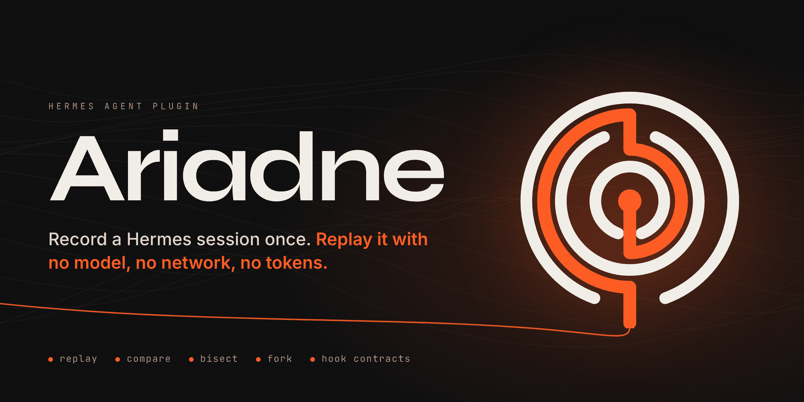
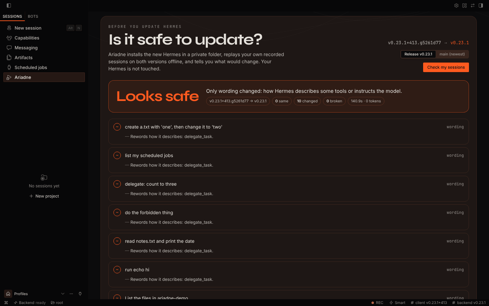
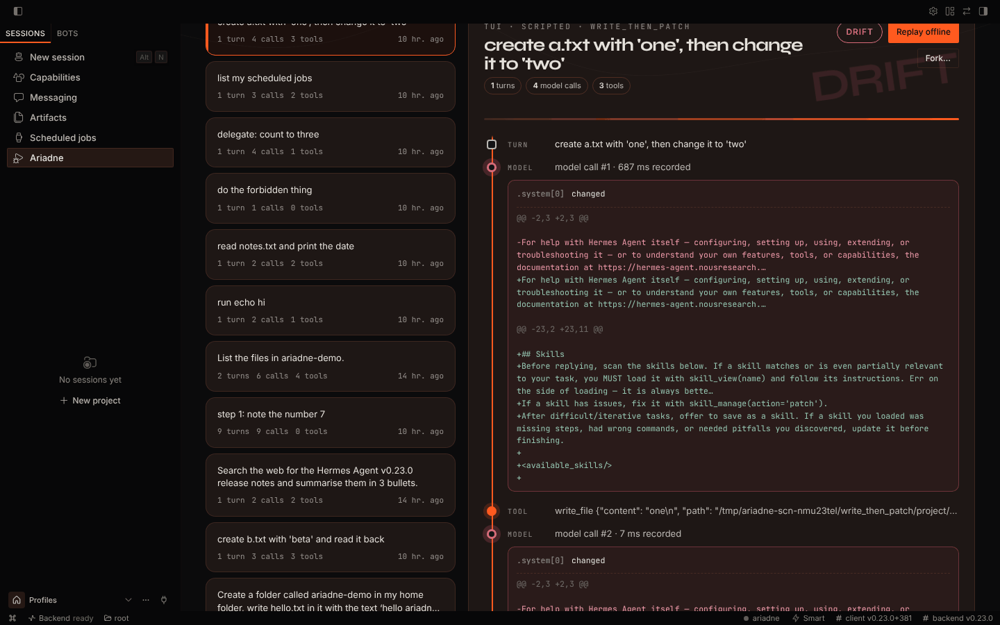

# Ariadne



[](https://github.com/miracle352/hermes-ariadne/actions/workflows/ci.yml) [](https://github.com/miracle352/hermes-ariadne/actions/workflows/watch.yml)

Record a Hermes session once. Replay it later with no model, no network and no tokens, and see
exactly what Hermes does differently.

Ariadne sits on Hermes's public middleware. While recording, it saves every model call, tool call
and user turn to a cassette. During a replay it answers the model calls and tool calls from that
cassette, so nothing runs and nothing is billed, while the rest of Hermes (prompt building,
tool-call parsing, compaction, hooks, subagents) runs for real. Any difference from the recording
is a change in Hermes.

```
hermes ariadne record on          # start saving new sessions
hermes ariadne play latest        # replay the last one offline
```

## Safe to update?

Before you update Hermes, check what the new version would do with your own sessions:

```
hermes ariadne upgrade-check              # the newest Hermes release
hermes ariadne upgrade-check --to main    # or main, any git ref, or a Hermes python path
```

Ariadne installs that Hermes into its own data folder (from the Hermes repository and its
`uv.lock`, using `git` and `uv`), replays your newest recordings on both versions side by side,
offline, and answers in plain words:

```
Ariadne upgrade check  ·  v0.23.0  ->  v0.23.1
SAFE TO UPDATE: 4 same, 0 changed, 0 broken  (114 s, offline replays)
```

When something changes it says what: tools added or removed, tool arguments changed, different
instructions, more model calls, a different final reply, or a hook promise that broke. Your own
Hermes is never touched. In Desktop it is the first tab of the Ariadne page; in chat,
`/ariadne update` shows the last result. The install step is the only part that uses the
network (git and the package index); the first check takes a few minutes, later ones reuse it.



## What you can do with it

**Check an upgrade before you trust it.** Replay your own sessions on a new Hermes build. Same
requests means nothing changed for you.

**Compare two installs.** `compare` replays one cassette on two Hermes installs side by side, so
anything that differs between the machines cancels out.

```
hermes ariadne compare latest --a ~/hermes-old/bin/python --b ~/hermes-new/bin/python
```

**Find the commit that changed something.** `bisect` replays a cassette across the commits of a
Hermes checkout and names the first one that behaves differently. Searching the 358 commits
between v0.23.0 and main took 10 replays and about a minute.

```
hermes ariadne bisect latest --repo ~/src/hermes-agent --python ~/src/hermes-agent/.venv/bin/python --good v0.23.0
```

**Fork a session.** Replay up to model call N, then let a live model take over from exactly that
state. Tools stay frozen by default: a call that matches the recording gets the recorded result,
anything new is refused without running.

```
hermes ariadne fork latest --at 3
hermes ariadne fork latest --at-turn 2 --prompt "do it without the terminal"
```

**Catch broken hook promises.** On every recording and replay Ariadne checks the promises in
Hermes's hook docs (every `pre_api_request` gets a `post_api_request`, `pre_llm_call` once per
turn, subagents start and stop in pairs, and so on). It found one that Hermes breaks:
[findings/001](findings/001-length-stopped-post-api-request/) (issue NousResearch/hermes-agent#150324, fix NousResearch/hermes-agent#150333).

## In Hermes Desktop

Ariadne adds a page to the Desktop sidebar. It lists your recordings, replays one with a click and
lights up each model call and tool call as the replay reaches it, with the exact difference shown
inline when something changed. You can fork from any turn, read past replays, and see which of
Hermes's documented hook promises held. A REC chip in the status bar turns recording on and off,
and recorded sessions get a small mark in the session list. It also ships an optional theme in
jet black, soft white and flame orange.

Install in one click: [hermes://plugin/install?repo=miracle352/hermes-ariadne&enable=1](hermes://plugin/install?repo=miracle352/hermes-ariadne&enable=1)

The Desktop half is off until you turn it on under Capabilities → Plugins, like every unified
plugin. Its backend routes only load when `ariadne` is in `plugins.enabled`.



## Training data

`export` turns a cassette into one entry in Hermes's own trajectory format (the ShareGPT layout
`agent/trajectory.py` writes), and a fork run into a preference pair: same prompt state, the
recorded reply on one side and the live model's reply on the other.

```
hermes ariadne export latest --out trajectories.jsonl
hermes ariadne export --fork <fork run dir> --prefer forked --out pairs.jsonl
```

## In chat

`/ariadne on`, `/ariadne off`, `/ariadne status`, `/ariadne last`, `/ariadne play` and
`/ariadne contracts` work in Desktop, the TUI, the CLI and messaging platforms.

## Commands

| command | what it does |
|---|---|
| `record on \| off \| status` | turn recording on or off for this profile |
| `list` | list cassettes |
| `show <id>` | print a cassette's turns, model calls and tool calls |
| `play <id>` | replay offline and report every difference |
| `compare <id> --a PY --b PY` | replay on two installs and diff them |
| `bisect <id> --repo DIR --python PY --good REF [--bad REF]` | find the first commit that changed the replay |
| `fork <id> --at N \| --at-turn K [--prompt TEXT] [--live-tools]` | live model from a recorded point |
| `export <id> \| --fork DIR [--prefer forked\|original] [--out FILE]` | trajectory or preference pair |

`<id>` can be a cassette id, a unique prefix, a path, or `latest`.

## What a replay compares

Both sides are scrubbed of secrets and have known-volatile values masked (dates, ids, durations,
paths). Some differences describe the machine rather than Hermes and are reported on their own
line, never counted as drift: the skills list, the toolchain and host lines, the conversation date
and the first-message note. A replay runs on a local stand-in for the recorded provider (signed-in
providers need credentials a replay never reads), so the provider's request extras are compared
separately too.

## Safety and what it touches

- **Off by default.** Nothing is recorded until you run `hermes ariadne record on` or set the
  `record` setting.
- **Local only.** Cassettes live in `<hermes home>/plugin-data/ariadne/`. Ariadne sends nothing
  anywhere. No telemetry.
- **Secrets.** API keys, tokens, private keys and similar are replaced with a hash before a
  cassette is written. Tool output can still contain private file contents, so read a cassette
  before you share it.
- **Replays run nothing.** Tools get placeholder arguments and their results come from the
  cassette; the replay driver answers every approval prompt with deny; outbound proxies point at a
  closed local port, and model calls go to a local stand-in that reports any call that reaches it.
- **Child processes.** `play`, `compare`, `bisect` and `fork` start Hermes
  (`python -m tui_gateway.entry`) as a child process and talk to it over its JSON-RPC protocol.
- **Reads outside its own data.** `play` copies this profile's `config.yaml` (with credential-
  looking keys removed), `SOUL.md`, `memories/` and `skills/` into a throwaway home so the replay
  sees the same context. It never reads `.env`, `auth.json` or any other credential store.
- **`fork` makes real model calls** with your configured provider, inside your own Hermes home, and
  the forked session shows up in your history. With `--live-tools`, tools after the fork point run
  for real, with Hermes's normal approvals.
- **`bisect` checks out commits** in the Hermes checkout you point it at. It refuses to start on a
  dirty tree and puts the original commit back when it finishes.

- **Replays only use safe settings.** A cassette's config (or the profile it clones) is filtered
  through an allowlist of settings that shape the request: toolsets, compression, agent limits,
  personality, memory limits and similar. Hooks, MCP servers, the terminal backend, auxiliary
  endpoints, shell in skills and every other setting that can run something or reach an endpoint
  are dropped, and the report lists what was left out. Only Ariadne and plugins you pass with
  `--with-plugin` load. `--trust-config` keeps everything, for cassettes you recorded yourself.
- **Decoding never imports what a cassette names.** Response objects are rebuilt only from the
  model SDKs Hermes reads (`openai.types`, `anthropic.types`, ...) and only as pydantic models;
  anything else becomes a plain attribute tree.

## How it compares

- **OrcaReplay** records at the network edge: it intercepts Hermes's TLS and serves the same bytes back. That works without touching Hermes, but it can't tell what Hermes meant to send, so any change to the prompt is just a byte mismatch. Its fork onto another model doesn't work on Hermes yet. Ariadne runs inside Hermes through the plugin middleware, so it can separate your machine's setup from real Hermes changes, check the hook contracts, bisect Hermes commits, and fork from any turn.
- **agent-run-debugger** imports a saved trace and shows it, with an inert replay that runs nothing. Ariadne's replay runs the real Hermes again, so it tells you what the current Hermes does with the same session.
- **`hermes record`** (PR #4446) captures tool calls so a workflow can be re-run later with a live model. That's automation; Ariadne is for testing: no model, and the result is a diff.

## Limits

- Streaming is not replayed token by token; a replay hands Hermes the assembled response.
- Hooks that fire inside the real tool dispatcher (`pre_tool_call`, terminal output transforms)
  don't fire during a replay, because tools never run.
- Recordings made in one surface replay in that surface (Desktop or TUI). `hermes -z` one-shot
  recordings replay through the TUI protocol and will show surface differences.
- Chat Completions and Anthropic Messages are covered. Other wire formats are recorded and
  replayed, but untested.

## In your plugin's CI

Record a few sessions with your plugin enabled, commit the cassettes, and add:

```yaml
- uses: actions/checkout@3d3c42e5aac5ba805825da76410c181273ba90b1  # v7.0.1
- uses: miracle352/hermes-ariadne@main
  with:
    cassettes: tests/cassettes/*.cassette.jsonl
    hermes-ref: v0.23.0
```

It installs Hermes at `hermes-ref` from its lock file, loads your plugin next to Ariadne, replays
every cassette offline and writes a table to the run summary. `fail-on: contract` fails only on
broken hook contracts, which is useful against `main`.

## Plugin compatibility

`ci/compat.py` checks real catalog plugins (listed in `ci/compat-plugins.txt`) against Hermes
releases and main: each is fetched at the commit the catalog pins, validated, and loaded into
offline replays, and any load failure or crashing hook is recorded. The `plugin-compat`
workflow runs it on GitHub's runners and the site shows the table.

## Tests

```
python -m pytest -c tests/pytest.ini --rootdir tests tests/unit
python tests/e2e/roundtrip.py <hermes-python>
python tests/e2e/fork_check.py <hermes-python>
python tests/scenarios/run.py <hermes-python> [<other-hermes-python>]
```

The scenarios use a scripted model server (plain code, `tests/support/scripted_model.py`), so the
whole suite runs offline for free: malformed tool arguments, unknown tools, 300 KB tool output,
empty, cut-off and refused replies, reasoning carriers, parallel tools, memory, write and patch,
async subagents, compaction, deferred tools and the Anthropic format.

Requires Hermes 0.23.0 or newer. MIT licensed.
